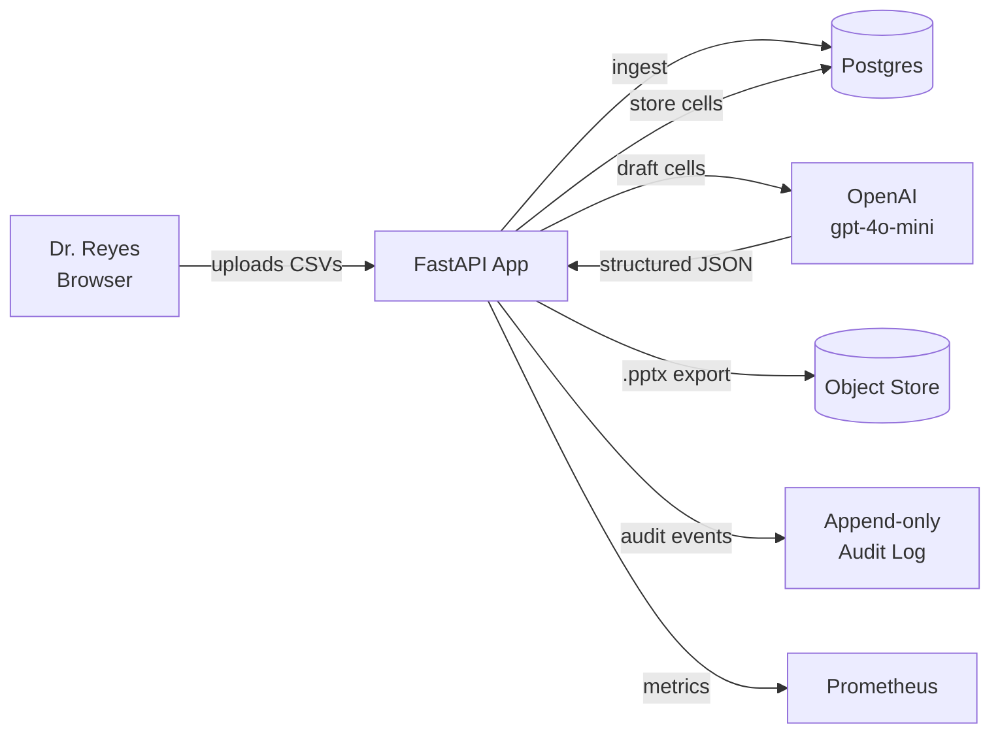
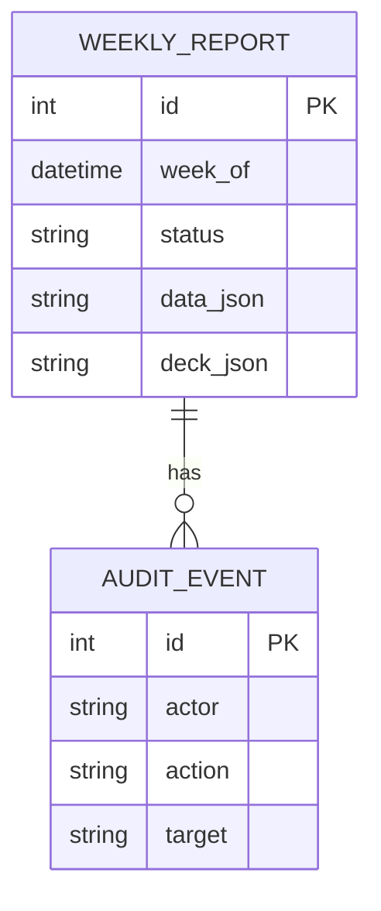

# Week 24: Portfolio Demo and Reflection

## Outcome

Produce the three artifacts that close the 24-week path: a **10-minute demo recording** that walks through the capstone from the customer's perspective, an **architecture diagram and tradeoffs document** that explains every non-obvious decision, and a **retrospective** that names the most important thing you learned and the next thing you will study. By the end of the week the repo has a `docs/` folder a hiring manager can read in 20 minutes and walk away with a clear picture of what you can do.

This is the easiest week of the path to under-invest in. The demo is the artifact the interviewer watches at 11pm the night before your interview. Spend the time.

## Setup Checklist

- [ ] The capstone repo from Weeks 21–23, with the smoke test passing
- [ ] A clean local environment that can run the system from scratch
- [ ] A screen recording tool (OBS Studio, Loom, QuickTime, or `asciinema` for terminal)
- [ ] A quiet hour with no notifications
- [ ] A friend or coworker willing to watch the demo and give feedback
- [ ] A blank `docs/retrospective.md` and `docs/architecture.md`

### Setup Walkthrough

```bash
cd /path/to/your/capstone-repo

# 1. Create the docs folder
mkdir -p docs
mkdir -p docs/diagrams
touch docs/architecture.md
touch docs/retrospective.md
touch docs/interview-prep.md
touch docs/demo-script.md

# 2. Test that the demo environment is reproducible
docker compose down -v
docker compose up -d db
make migrate
make run &
sleep 3
curl -s http://localhost:8000/health
# expected: {"ok": true}
```

If the curl returns anything other than `{"ok": true}`, do **not** record the demo. Fix the environment first.

## Learning Path (60–90 minutes)

**Best approach:** Read **one** good example of each artifact — a recording, an architecture diagram, a retrospective — and notice the shape. Do not copy content; copy structure.

### Learn in this order

1. **What a hiring manager looks for in the first 60 seconds** — context, then problem, then result
2. **Architecture diagrams that explain decisions** — boxes are not enough; the lines must carry meaning
3. **The 10-minute demo arc** — cold open, problem, demo, tradeoffs, close
4. **Mermaid** — a text-based diagram format that lives in markdown
5. **Retrospectives that change behaviour** — what you will do differently, not what you felt
6. **Interview questions about the capstone** — the ones you cannot answer are the ones to study
7. **The 30-second pitch** — practice until it is not a script

### Free Resources

- [Mermaid Docs](https://mermaid.js.org/) — the diagram syntax you will use
- [Charity Majors: The Art of Giving and Receiving Code Review](https://www.youtube.com/watch?v=PJjmw9TRB7s) — how to talk about your work
- [Will Larson: An Elegant Puzzle: Systems of Engineering Management](https://lethain.com/elegant-puzzle/) — how engineers narrate decisions
- [GitHub: Mermaid support](https://github.blog/developer-skills/github/how-to-use-mermaid-diagrams-in-github/) — diagrams render in your README
- [Loom: How to record a great demo](https://support.loom.com/hc/en-us/articles/360002208397) — the practical recording workflow
- [Excalidraw](https://excalidraw.com/) — hand-drawn-style diagrams for the architecture overview
- [The Pragmatic Engineer: Engineering management](https://blog.pragmaticengineer.com/) — how to talk about systems in interviews

**Tip:** Watch one engineering demo on YouTube (search "platform demo" or "infrastructure demo") and notice the rhythm. The best ones open with the user, not the system.

## Micro-Exercises (45–60 minutes)

Complete these in order. Each one produces a document you will reuse in the next ones.

### Exercise 1 — Write the 30-second pitch

```text
Hi, I'm Ernest. I spent 24 weeks learning to become a forward-deployed AI
engineer. My capstone is the Acme Monday Report — an AI-assisted weekly
report drafter for a regional health insurer's operations team. It cuts
the team's Monday-morning report time from 5 hours to 90 minutes, with
every cell grounded in source data and a human in the loop. The repo
has a one-command setup, a full test suite, security hardening, and a
deploy that runs in CI. I'd love to walk you through it.
```

**Step-by-step:**
1. Write it in plain text first. No slides, no props.
2. The pitch has three parts: who you are, what you built, why it matters.
3. Time yourself. If it is over 30 seconds, cut adjectives.
4. Practice out loud five times. The first three will be wrong; the last two will be close.

### Exercise 2 — Sketch the architecture diagram in Mermaid



**Step-by-step:**
1. The diagram has 4–8 nodes. More than that and it stops being a diagram.
2. Edges are labelled with the **verb** of the interaction: "ingest", "draft", "audit".
3. The diagram is in `docs/diagrams/architecture.md` and rendered in your README.
4. Add a second diagram for the data model if it is non-trivial.



### Exercise 3 — Write the architecture and tradeoffs document

```markdown
# Architecture and tradeoffs

## At a glance
The system is a single FastAPI service backed by Postgres, with an
out-of-process LLM call and an append-only audit log. It is deployed
to Fly.io with managed Postgres. CI runs on GitHub Actions.

## Component diagram
See `docs/diagrams/architecture.md`.

## Key decisions

### Decision 1: One service, not microservices
- **What:** Everything is in one FastAPI app — the API, the LLM call,
  the audit log, the .pptx export.
- **Why:** At 1–100 customers, splitting hurts more than it helps.
- **Cost:** The whole service has to redeploy together; an LLM outage
  takes down the API too.
- **When to revisit:** When the team is > 5 engineers, or when the
  LLM call volume justifies a dedicated worker pool.

### Decision 2: Postgres over SQLite
- **What:** Production uses Postgres; tests use SQLite in-memory.
- **Why:** Real concurrency, real backups, real point-in-time recovery.
- **Cost:** One more thing to operate; one more thing to break in dev.
- **When to revisit:** Never. Postgres is the right default for a
  service that has any non-trivial data.

### Decision 3: OpenAI over a self-hosted model
- **What:** We use the OpenAI API with a small model.
- **Why:** At 1 customer, the cost of running a self-hosted model
  dwarfs the savings.
- **Cost:** A vendor dependency and a per-token cost that scales with
  use.
- **When to revisit:** When the LLM cost exceeds $1k / month, or when
  the customer requires on-prem.

### Decision 4: PPTX export in-process
- **What:** The .pptx is built by the same service that handles the
  API.
- **Why:** At 1–50 customers per week, the export is fast enough.
- **Cost:** A long export blocks the API worker.
- **When to revisit:** When exports take > 30s or block other requests.

## What I would change next
1. Add a dedicated worker for LLM calls so a slow model does not
   block the API.
2. Add multi-customer tenancy and a per-tenant rate limit.
3. Move the .pptx export to a background job.
```

**Step-by-step:**
1. Each decision has four parts: what, why, cost, when to revisit.
2. The "when to revisit" line is the one that tells the reader you
   thought about scale.
3. The "what I would change next" list is the most honest part of the
   document — every engineer has one.
4. Keep it under 4 pages. A 20-page architecture doc is a sign you
   are still designing, not delivering.

### Exercise 4 — Write the retrospective

```markdown
# Retrospective

## What I set out to build
Become competitive for forward-deployed AI engineer roles by building
and deploying real systems, not by collecting certificates.

## What I actually built
- A full-stack Customer Engagement Tracker (Phase 2)
- An LLM-powered request assistant with structured output and
  evaluation (Phases 3–4)
- A containerised, CI/CD'd, observability-instrumented service
  (Phase 5)
- An end-to-end AI product for a synthetic customer: the Acme
  Monday Report (Phase 6)

## What worked
- **20/70/10 split.** The forced 10% on explanation and reflection
  was the most important habit. Explaining the work in my own words
  caught more bugs than the test suite.
- **One-command setup.** Every project in the path has `make
  install && make test && make run`. That alone saved hours of
  context switching.
- **Real customers, even synthetic ones.** Writing the persona and
  the requirements doc before writing code made the build weeks
  dramatically more focused.

## What did not work
- **Skipping the AI-off checks on busy weeks.** I rushed through a
  few. The interviews where I had to code live were exactly the
  weeks I had skipped the practice.
- **Over-engineering the first version of each lab.** The first
  FastAPI app had middleware for things I did not need until Week
  20. I learned to ship the smallest version that runs, then add.
- **Treating the cost model as a final-week task.** It should be
  written in Week 12 and updated weekly. I rewrote it three times.

## The one thing I would tell a friend starting this path
- Build a 30-second pitch for every project before you start
  building. If you cannot describe what success looks like in 30
  seconds, you are not ready to code.

## What I will study next
- **System design interviews.** I can build systems; I cannot yet
  talk about them on a whiteboard. I will do 2 mock interviews a
  week for 6 weeks.
- **Real-time LLM streaming.** All my demos wait for the full
  response. Streaming would change the user experience.
- **A second product.** The next 12 weeks will be a second
  end-to-end product, with a different customer persona, to test
  whether the first was skill or luck.
```

**Step-by-step:**
1. The retrospective is **four** sections: what you set out to do, what worked, what did not, what is next.
2. Every claim in "what worked" / "what did not" should be backed by a specific week or project.
3. "The one thing I would tell a friend" is the most-read paragraph of any retrospective. Make it count.
4. The retrospective is a document, not a journal entry. Write it for a reader, not for yourself.

### Exercise 5 — Write the interview-prep one-pager

```markdown
# Interview prep — Acme Monday Report

## The 30-second pitch
Hi, I'm Ernest. I spent 24 weeks learning to become a forward-deployed
AI engineer. My capstone is the Acme Monday Report — an AI-assisted
weekly report drafter for a regional health insurer's operations team.
It cuts the team's Monday-morning report time from 5 hours to 90
minutes, with every cell grounded in source data and a human in the
loop. The repo has a one-command setup, a full test suite, security
hardening, and a deploy that runs in CI.

## Common questions and answers

### "Walk me through the system."
- A FastAPI service exposes three endpoints: create a report, draft
  the deck, approve the deck.
- Drafting calls the LLM with structured output; the response is
  validated by Pydantic and stored as JSON.
- Every state change writes an append-only audit event.
- Postgres stores both the raw data and the generated cells.

### "What was the hardest technical problem?"
- The hardest part was the cost model. The LLM cost scales with
  report volume, and at 100 customers the cost per customer drops
  but the absolute cost rises. I had to make the trade-off explicit
  in the requirements doc and the cost model, not in the code.

### "What would you do differently?"
- Add a dedicated worker for LLM calls. Today, a slow LLM response
  blocks the API worker. A background queue would isolate the two.

### "How do you know it works?"
- The smoke test exercises the full flow. The property-based tests
  catch edge cases in the service layer. The audit log gives me
  ground truth on what the system actually did, separate from what
  it was supposed to do.

### "What was the biggest surprise?"
- How much of the work was non-code. The discovery doc, the persona,
  the requirements doc, the cost model — together they are more
  important than the FastAPI service. The code is the easy part.

## Things I cannot yet answer
- Multi-region deployment. I have not done it.
- Vector search at scale. I have built a small RAG; I have not
  operated a 100M-vector index.
- Live coding under time pressure. I need more practice.

## What I will study next
- System design whiteboard practice
- Real-time LLM streaming
- A second product
```

**Step-by-step:**
1. The "common questions" section is the one you rehearse out loud.
2. The "things I cannot yet answer" section is the one that turns an interview into a real conversation.
3. Keep the file under 2 pages. Memorise the pitch, not the file.
4. Re-read this before every interview. The week before, not the day before.

### Exercise 6 — Write the demo script

```markdown
# Demo script (10 minutes)

## 0:00 — Cold open
"Hi, I'm Ernest. This is the Acme Monday Report — the capstone from my
24-week learning path. The customer is a regional health insurer's
operations team, and the problem is their Monday morning."

## 0:30 — The problem
"For 4 hours every Monday, a senior manager and her team copy data
from 4 CSV exports into a master spreadsheet, then hand-draft a
PowerPoint for the VP. The output is one week old by the time the VP
sees it. My capstone cuts that to 90 minutes and makes the data 2
days old instead of 7."

## 1:30 — Show the requirements
"Here is the requirements doc I wrote in Week 21. Three functional
requirements, three non-functional, three success metrics, and a
counter-metric. I wrote this before I wrote a line of code."

## 3:00 — Live demo
- Open the repo
- `make install`
- `docker compose up -d db && make migrate`
- `make run`
- `curl /health` — show 200
- Open `/docs` — show the OpenAPI UI
- Create a report, draft it, approve it, show the response bodies
- Show the audit log
- Show the .pptx export

## 7:00 — Show the engineering
"Here is the CI pipeline — every push runs lint, type-check, matrixed
tests, a Docker build, a security audit, and a deploy. Here is the
coverage report. Here is the cost model. Here is the disaster-recovery
one-pager."

## 8:30 — Tradeoffs
"I made five key decisions. The biggest one was to use the OpenAI API
over a self-hosted model. At one customer, the operational cost of
self-hosting dwarfs the savings. At 100 customers, the trade-off flips."

## 9:30 — Close
"I'm Ernest. I would love to work on a real customer problem. Thanks
for watching."

## Total: 10 minutes
```

**Step-by-step:**
1. The first 30 seconds matter most. Open with the customer, not the code.
2. Rehearse the demo at least three times before recording. The third time will be the cleanest.
3. Have a backup plan for every step. If `make run` fails, switch to a screencast you recorded earlier.
4. The tradeoffs section is what separates a junior demo from a senior demo. Do not skip it.

### Exercise 7 — Record the demo

**Step-by-step:**
1. Reset the environment: `docker compose down -v`, fresh DB, fresh `audit.log`.
2. Open the terminal, browser, and editor. Have the script in a sticky note above your screen.
3. Press record. Take a breath. Begin with the cold open.
4. If you make a mistake, stop, restart the recording. Do not edit a flubbed take.
5. The final recording is the third or fourth take, not the first.

### Exercise 8 — Get one external review

**Step-by-step:**
1. Send the demo link, the architecture doc, and the retrospective to one person who has not seen your work.
2. Ask them to write, in two paragraphs, what they think you built and what they would ask in an interview.
3. If their summary does not match yours, the docs need another pass.
4. Document the feedback and the changes in `docs/review.md`.

### Exercise 9 — Update the root README

**Step-by-step:**
1. The root `README.md` is the first thing a hiring manager reads. It must contain:
   - The 30-second pitch
   - A link to the demo recording
   - A link to the architecture doc
   - A link to the retrospective
   - A link to the live system (if deployed)
2. Below the first screen, link to the deeper docs. Do not dump them inline.
3. Add a screenshot of the running app. A picture is worth a thousand words in a README.

### Exercise 10 — Write the "what's next" document

```markdown
# What's next

## In the next 4 weeks
- Two mock interviews per week
- One new system-design whiteboard problem solved per week
- One new piece of the capstone shipped per week (real-time LLM
  streaming, multi-customer tenancy, a worker queue)

## In the next 12 weeks
- A second end-to-end product, with a different customer persona
- A blog post on each of: discovery, cost modelling, disaster
  recovery, AI safety in production
- A contribution to an open-source LLM tool (e.g. LiteLLM,
  Pydantic AI, or a small LangChain alternative)

## In the next 6 months
- Apply to 20 forward-deployed engineer roles
- Track every application in a spreadsheet (company, role, link,
  date applied, date heard back, outcome)
- Aim for 5 phone screens, 3 on-sites, 1 offer

## The single most important thing
- The single most important thing is to keep building. The path
  ends here; the work does not.
```

**Step-by-step:**
1. The "what's next" doc is the last one you write. It is the bridge from the path to the rest of your career.
2. Every line is a commitment, not a wish. "Apply to 20 roles" is a number; "look for opportunities" is a wish.
3. Save it. Read it again in 4 weeks. Adjust it.

---

## Main Lab: Demo, Architecture, and Retrospective (4–5 hours)

### Scenario

It is the end of the path. You have built a real system. Now you have to **show** it. The deliverable is a polished, watchable demo and three documents that an interviewer can read in 20 minutes and walk away knowing what you can do.

### Target File Layout

```
my-capstone/
  docs/
    architecture.md
    retrospective.md
    interview-prep.md
    demo-script.md
    diagrams/
      architecture.md
    review.md
    whats-next.md
  README.md          # updated
  docs/demo.mp4      # the recording
```

### Build Steps

**Commit after each step.** Aim for one commit per step.

#### Step 1 — Write the 30-second pitch

*`docs: write 30-second pitch`*

Use Exercise 1. Memorise it. The next 9 steps depend on it.

#### Step 2 — Sketch the architecture diagram

*`docs: add mermaid architecture diagram`*

Use Exercise 2. Render it in your README and in `docs/architecture.md`.

#### Step 3 — Write the architecture and tradeoffs document

*`docs: write architecture and tradeoffs`*

Use Exercise 3. The four-part decision format is the structure; the content is yours.

#### Step 4 — Write the retrospective

*`docs: write retrospective`*

Use Exercise 4. The four sections are required. The "one thing I would tell a friend" line is the most important.

#### Step 5 — Write the interview-prep one-pager

*`docs: write interview prep one-pager`*

Use Exercise 5. Rehearse the pitch and the common questions out loud.

#### Step 6 — Write the demo script

*`docs: write demo script`*

Use Exercise 6. Time yourself reading it out loud. Adjust the length until it is 9:30–10:00.

#### Step 7 — Record the demo

*`demo: record 10-minute demo`*

Use Exercise 7. The third take is the one you ship.

#### Step 8 — Get external feedback and update the docs

*`docs: incorporate external feedback`*

Use Exercise 8. Document the feedback in `docs/review.md`.

#### Step 9 — Update the root README

*`docs: update root readme`*

Use Exercise 9. The first screen of the README is the entire pitch for the project.

#### Step 10 — Write the "what's next" document and close the path

*`docs: write whats-next and close the path`*

Use Exercise 10. Commit it. Tag a release. Write one final commit message to yourself.

### Required Manual Tests

- [ ] The 30-second pitch takes 25–35 seconds when read aloud
- [ ] The demo recording is 9–10 minutes long
- [ ] The architecture diagram renders in GitHub's markdown preview
- [ ] The architecture document has at least 3 decisions in the four-part format
- [ ] The retrospective has the four required sections
- [ ] The interview-prep doc has the "things I cannot yet answer" section
- [ ] The root README's first screen contains the pitch and the demo link
- [ ] At least one person outside your head has reviewed the docs and given feedback
- [ ] The system still runs (`make test` passes, `make run` works)

### Acceptance Criteria

- [ ] `docs/architecture.md`, `docs/retrospective.md`, `docs/interview-prep.md`, `docs/demo-script.md`, `docs/whats-next.md` all exist with content
- [ ] `docs/diagrams/architecture.md` contains a Mermaid diagram that renders
- [ ] `docs/demo.mp4` (or equivalent) exists and is 9–10 minutes long
- [ ] The root README links to all five docs and the demo
- [ ] The 30-second pitch is memorised
- [ ] The retrospective names at least one thing that did not work
- [ ] The interview-prep doc has at least 3 common questions with answers
- [ ] The "what's next" doc has at least one specific number per time window
- [ ] At least 5 meaningful commits
- [ ] You can deliver the pitch, walk through the architecture, and answer the 3 interview questions without notes

## AI-Off Check (30 minutes)

**Without looking at any of your docs**, deliver the following in one minute, out loud, to a friend or a mirror:

1. The 30-second pitch
2. The architecture diagram, in two sentences
3. The single most important thing you learned
4. The single most important thing you will study next

If you cannot deliver all four cold, the work is not yet internalised. The path ends when you can talk about the work without the docs.

## Reflection Questions

After you finish, write answers to these in `docs/reflection-week-24.md`:

1. If you were to start the path over, what is the first thing you would change?
2. Which of the 24 weeks had the biggest impact on the way you work today?
3. Which of the 24 weeks was the biggest waste of your time, in retrospect?
4. What is the one project you would still build, given unlimited time, before you start interviewing?
5. What is the single sentence you would put on a T-shirt to describe the path?

## Next Steps

Once you pass all acceptance criteria:

1. Tag a release: `git tag -a v1.0.0 -m "End of the 24-week path"`
2. Push the tag
3. Write the reflection answers
4. **Start the next thing.** The path is a means; the work is the end.

---

**Ready?** Start by writing the 30-second pitch in plain text. Then open a timer and rehearse it. When you can deliver it in 30 seconds, start the architecture diagram. Good luck! 🎯

**You finished the path. Now go build the next thing.**
